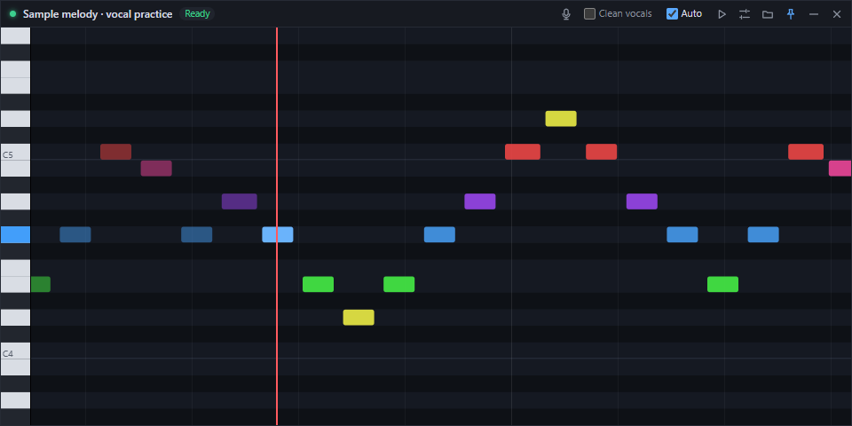

# floatfall

Licensed under the [MIT License](LICENSE). Third-party dependencies and model weights retain their respective licenses.

A Chrome extension and an Electron app that work together. The extension finds the YouTube video you are watching. The desktop app then:

1. downloads a low-quality copy with `yt-dlp`,
2. extracts WAV audio with `ffmpeg`, preserving 44.1 kHz stereo when cleaning vocals,
3. optionally isolates vocals with BS-RoFormer (or **your** separator command), then converts them to mono at the transcription sample rate,
4. transcribes the melody with **your** transcription command,
5. shows the notes as a piano roll in a small frameless window that stays on top of other windows. The roll follows the YouTube playhead. Click the roll to seek the video.

Model wrappers are included for BS-RoFormer vocal isolation and MuScriptor melody transcription. Choose and download them from the desktop app’s **Settings → Models** menu, or configure custom commands as shown below.



```
apps/extension   Chrome MV3 extension (Effect background worker, tiny content script, React popup)
apps/desktop     Electron app (Effect services in main, React + canvas renderer)
packages/protocol  Shared Effect Schemas for the WebSocket protocol and note format
examples/        Stub separator/transcriber scripts for testing the pipeline
```

## Setup

Requirements: Node 22+, plus `yt-dlp` and `ffmpeg` on your PATH (or set absolute paths in settings).

```powershell
npm.cmd install
npm.cmd run build:extension   # -> apps/extension/dist
npm.cmd run dev               # starts the desktop app (Electron downloads itself on first run)
```

To load the extension, open `chrome://extensions`, turn on Developer mode, click **Load unpacked**, and select `apps/extension/dist`.

Only videos of 7 minutes or less are detected (`MAX_VIDEO_SECONDS` in `packages/protocol/src/lite.ts`). The content script reports the length of the main video, ignoring ads. The extension ignores longer videos and live streams, and the popup explains why. As a backup, the desktop app also passes `--match-filter` to `yt-dlp`.

The extension connects to `ws://127.0.0.1:47615`. The green dot in the window title bar shows that it is connected.

## Live singing note

Click the **microphone button** in the title bar to show your live singing note over the piano roll. The display shows the note and octave, frequency, tuning offset in cents, and microphone level. A green horizontal guide marks your pitch on the piano roll when it is within the displayed range.

Use **Pop out ↗** to move the display to its own draggable, resizable window that stays on top, or **Dock ↙** to put it back over the roll. The floating display keeps working when the main window is minimized. You can select your microphone from the display's input menu.

The **Recent pitch** graph keeps the last 12 seconds of your singing, with gaps during silence. Your recent pitch also leaves a green trail on the piano roll. Use **+1 octave** to shift only the displayed microphone note and its history up 12 semitones. The song's transcribed notes stay at their original pitches. Docking and popping out keep the same history and octave setting.

The microphone starts only when you turn it on. Turn it off with the title-bar button or the display's **×** button; closing the floating window also releases the microphone. Microphone audio is analyzed locally, without recording, uploading, or playing it through your speakers. It starts off again when the app is relaunched or reloaded. For the clearest reading, use headphones while a YouTube video is playing.

Pitch tracking uses [Pitchy's McLeod method](https://github.com/ianprime0509/pitchy), a 4096-sample analysis window, noise/clarity gates, and a short median filter. It follows one singing voice at a time, with A4 = 440 Hz as the tuning reference. This runs independently of the YouTube transcription models and needs no GPU.

## Plugging in models

Click the settings icon in the title bar to open the settings window:

- **Models:** choose MuScriptor small, medium, or large and an NVIDIA CUDA or CPU device. Open the selected model’s Hugging Face page to accept its license/access conditions, then download its weights. If needed, paste a read token from the same account; Hugging Face stores it in its local credential cache, never in `settings.json`. Existing `hf auth login` credentials and `HF_TOKEN` are also supported. Select BS-RoFormer to configure and download optional vocal isolation (requires an NVIDIA GPU for processing).
- **Processing:** choose local processing or a remote worker, configure shared tokens, enable the worker server, and control automatic transcription. Models on this computer apply to local jobs and jobs it serves; a remote worker uses its own models.
- **Advanced:** set paths for `uv`, `yt-dlp`, and FFmpeg, set the audio cache, or edit custom separator/transcriber commands. Included model scripts require [uv](https://docs.astral.sh/uv/getting-started/installation/); the first download installs their pinned Python dependencies and can take several minutes and several GB of disk space.

Click **Save changes** (or Ctrl/Cmd+S) to apply configuration to new jobs. **Download / verify weights** immediately prepares the selected model independently of saving; downloads show progress and errors, can be cancelled/retried, and keep running if the settings window closes. Cached files are reused on later downloads and model runs. A successful download verifies the weights, not GPU compatibility.

For manual configuration, **Advanced → Open settings.json** opens the file in Electron’s `userData` folder. Valid manual edits reload automatically; if you have unsaved edits in the settings window, reload them before saving to avoid overwriting external changes.

```jsonc
{
  "uvPath": "uv",              // executable used by included model presets and downloads
  "ytDlpPath": "yt-dlp",
  "ffmpegPath": "ffmpeg",
  "downloadFormat": "worst[acodec!=none]/worstaudio/worst", // yt-dlp -f selector
  "sampleRate": 44100,
  "cacheDir": "",              // empty = <userData>/cache
  "cleanVocals": false,        // also toggled from the window
  "autoTranscribe": true,      // also toggled from the window
  "separator": {
    "command": "python",
    "args": ["C:/models/separate.py", "{input}", "{output}"]
  },
  "transcriber": {
    "command": "python",
    "args": ["C:/models/melody.py", "--in", "{input}", "--out", "{output}"],
    "output": "json"           // or "midi"
  }
}
```

You can use these placeholders in `args`: `{input}`, `{output}`, `{outputDir}`, `{videoId}`, `{sampleRate}`.

Your separator and transcriber commands must follow these rules:

- **Separator:** read the 44.1 kHz stereo WAV at `{input}` and write the vocal stem as a WAV to `{output}`. The pipeline converts the stem to mono at `sampleRate` before transcription.
- **Transcriber:** read the WAV at `{input}` and write the notes to `{output}`:
  - JSON format: `{"notes":[{"pitch":60,"start":1.25,"end":1.5,"velocity":0.8}]}` or a bare array. `pitch` is a MIDI note number and times are in seconds.
  - MIDI format: a standard `.mid` file.
- **Progress (optional):** print lines that contain `NN%` and the title bar shows a progress bar. A non-zero exit code shows the last lines of the tool's output in the window.

### BS-RoFormer (vocal isolation)

`models/separate_vocals.py` runs the BS-RoFormer ViperX 1297 checkpoint through [audio-separator](https://github.com/karaokenerds/python-audio-separator). It uses CUDA on Windows/Linux, downloads the model automatically, and writes only the vocal stem. PyTorch and the separator dependencies are pinned in `models/separate_vocals.py.lock`.

Add this to your desktop settings to enable it:

```jsonc
"cleanVocals": true,
"separator": {
  "command": "uv",
  "args": ["run", "--locked", "--script", "<repo>/models/separate_vocals.py", "{input}", "{output}"]
}
```

If FFmpeg is not on PATH, append `"--ffmpeg", "C:/path/to/ffmpeg.exe"` to the arguments and set `ffmpegPath` to that same executable. The wrapper caches weights under `%LOCALAPPDATA%/floatfall/models/audio-separator` on Windows or `~/.cache/floatfall/models/audio-separator` on Linux. Override this with `--model-dir`. Use `--segment-size 128` if GPU memory is tight; the default is 256 with a batch size of one.

To download the model before processing a video:

```powershell
uv run --locked --script models/separate_vocals.py --download-only
```

The app's vocal-cleaning toggle bypasses separation when disabled. Existing stems made from mono audio are not reused by the stereo pipeline.

### MuScriptor (melody transcription)

`models/muscriptor_transcribe.py` is a [uv](https://docs.astral.sh/uv/) script that runs [MuScriptor large](https://huggingface.co/MuScriptor/muscriptor-large) on an NVIDIA GPU by default. Its dependencies are listed inside the script itself and pinned in `models/muscriptor_transcribe.py.lock`.

1. Accept the licence on the model page. The weights are gated and licensed CC BY-NC 4.0, and you must have the rights to the audio you transcribe.
2. Authenticate once with `uvx hf auth login`, or set `HF_TOKEN`.
3. Point the transcriber at the script:

```jsonc
"sampleRate": 16000,  // MuScriptor works at 16 kHz internally
"transcriber": {
  "command": "uv",
  "args": ["run", "--locked", "--script", "<repo>/models/muscriptor_transcribe.py", "{input}", "{output}", "--model", "large", "--device", "cuda"],
  "output": "json"
}
```

Options you can add to `args` after `{output}`:

- `--model small|medium|large` (default `large`).
- `--instruments voice`, the default, which only allows the singing-voice group. Pass `""` to allow every instrument.
- `--poly` keeps chords. By default the output is reduced to one line, keeping the highest pitch at each moment.
- `--device cuda` (default). The script reports an error if CUDA is unavailable. Use `--device cpu` to explicitly run on the CPU.

On Windows and Linux, the script installs matching CUDA 12.8 builds of PyTorch and torchaudio from the PyTorch index. Keep your NVIDIA driver up to date; a separate CUDA toolkit installation is not required. The first run downloads the dependencies and model weights. `FLOATFALL_MUSCRIPTOR_MODEL` and `FLOATFALL_MUSCRIPTOR_DEVICE` can override the defaults when the corresponding command-line options are omitted.

To test the plumbing without a real model, use the stubs in `examples/`:

```jsonc
"separator":   { "command": "node", "args": ["<repo>/examples/passthrough-separator.mjs", "{input}", "{output}"] },
"transcriber": { "command": "node", "args": ["<repo>/examples/fake-transcriber.mjs", "{input}", "{output}"] }
```

## Processing on another instance

Every desktop instance can process its own videos, serve as a worker for other instances, or do both. Configure this in **Settings → Processing**, or set these options in each machine’s `settings.json` through **Settings → Advanced**. Changes apply when saved.

On the machine with your models/GPU, keep your separator and transcriber commands configured and add:

```json
"worker": {
  "enabled": true,
  "host": "0.0.0.0",
  "port": 47616,
  "token": "replace-with-a-long-random-shared-secret"
}
```

Generate a token with `node -e "console.log(require('node:crypto').randomBytes(32).toString('hex'))"`, then copy it to the client configuration. Tokens must contain at least 16 characters. The worker is disabled by default and binds to `127.0.0.1` unless you choose another host. Use `0.0.0.0` to accept connections from other machines and allow inbound TCP port 47616 in the worker's firewall.

On the machine where you watch YouTube, add the worker's LAN or VPN address:

The default remote address is `ws://192.168.2.6:47616`. If an existing `settings.json` has an empty `remote.url`, set it to this address; set `remote.token` to the same token configured on the worker.

```json
"remote": {
  "url": "ws://192.168.2.6:47616",
  "token": "replace-with-a-long-random-shared-secret"
}
```

An empty `remote.url` uses local processing. A configured remote worker handles downloading, audio extraction, optional cleaning, and transcription using **its own** model commands and sample rate. The client needs no model installation, `yt-dlp`, or `ffmpeg`. Only the YouTube video ID and cleaning choice are sent; microphone analysis remains on the client. Worker requests always execute locally, even if that instance also has a remote worker configured, so instances cannot accidentally forward jobs in a loop.

The **Remote** badge shows where processing runs; hover over it to see which matching stages are cached on the worker. The **Worker** badge indicates an active server, and its tooltip includes the listen address. Startup errors also appear there. Progress and errors stream back to the requesting instance. Cancel, disconnect, or closing the client releases its job; shared work continues while another client still needs it. Each worker processes one distinct job at a time to avoid competing for GPU memory, while identical requests share a run. A lost connection shows an error; use Retry after reconnecting.

Before a remote job starts, the client checks the worker's cache and model fingerprint. Completed notes are returned directly, even if original media was removed. Otherwise, cached vocals or extracted audio skip the corresponding earlier stages. Different cleaning modes and changed model settings use different results. The worker keeps the shared disk cache, so repeated requests from any client can reuse it across worker restarts. Cache inspection exchanges fingerprints and availability rather than model commands or credentials.

Use `ws://` on a trusted LAN or VPN. For encrypted connections across other networks, put the worker behind a TLS WebSocket proxy and use a `wss://` URL. This worker protocol is separate from the browser extension's local bridge on port 47615.

## Caching

- **On disk:** each stage writes into `<cache>/<videoId>/`. Each tool first writes a `*.partial.*` file, which is renamed only when the tool succeeds, so a cancelled run never leaves a broken result behind. Separator and transcriber output files are named with a hash of their command settings. Changing a command in settings re-runs only the stages that it affects.
- **In memory:** an Effect `Cache` sits on top of the disk cache. Switching back to a tab you already transcribed shows its notes instantly. Two requests for the same video share one run. A run is interrupted, and its child process killed, once nothing is waiting for it.

## Design notes

- **Event handlers stay light.** Chrome listeners, WebSocket callbacks, IPC handlers and React handlers only push a value onto an Effect `Queue` or send one IPC message. All work that does not change the UI runs in Effect fibers: tab selection, socket I/O, downloading and model runs. Switching videos interrupts the running job through a `FiberHandle`.
- **Updates go over three IPC channels:** state (small, rarely changes), notes (large, sent once per transcription) and playback (frequent). Playback never causes a React render: the animation loop reads it each frame and works out the playhead position between updates.
- **Expensive work in the renderer is memoized.** The note index (sorted note start times and pitch range) is computed with `useMemo`. The keyboard and lane background is drawn once per size or pitch range into an offscreen canvas. Each frame binary-searches for the notes that are on screen. Components use `memo`.
